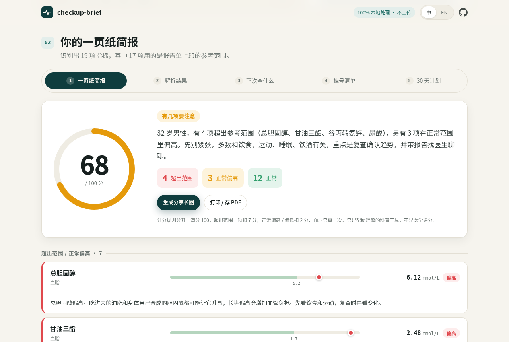
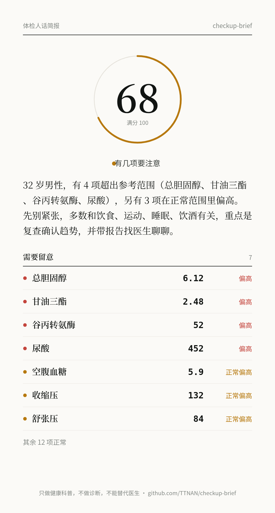
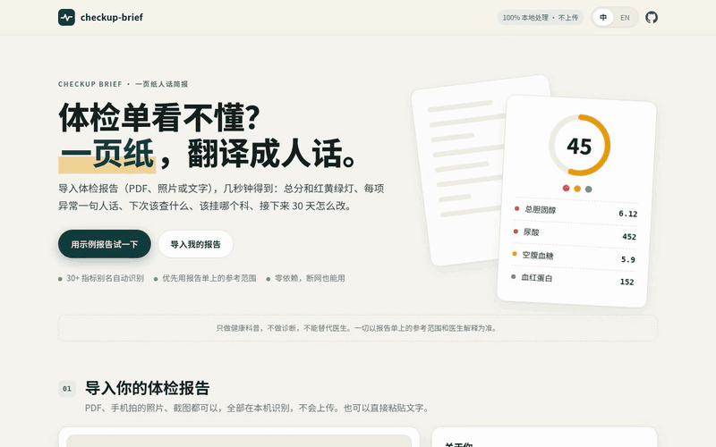
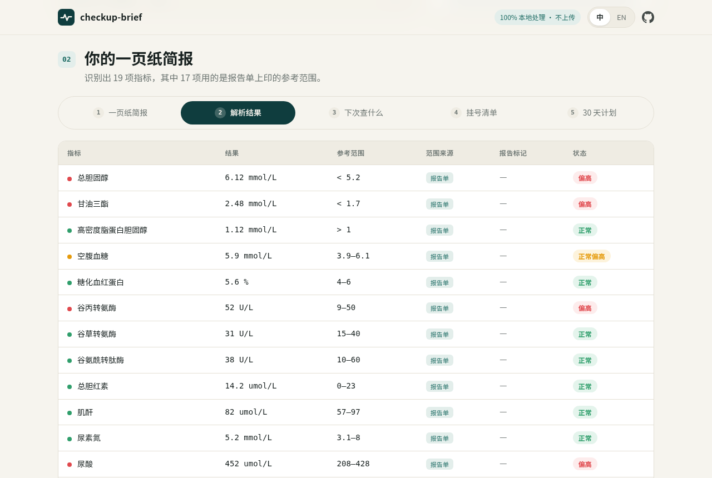
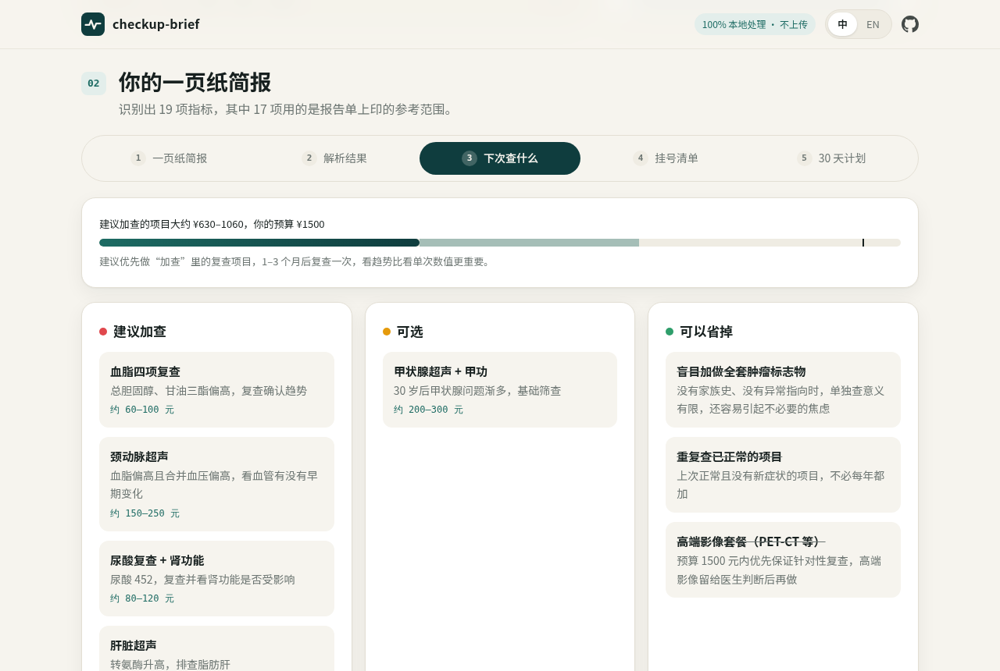
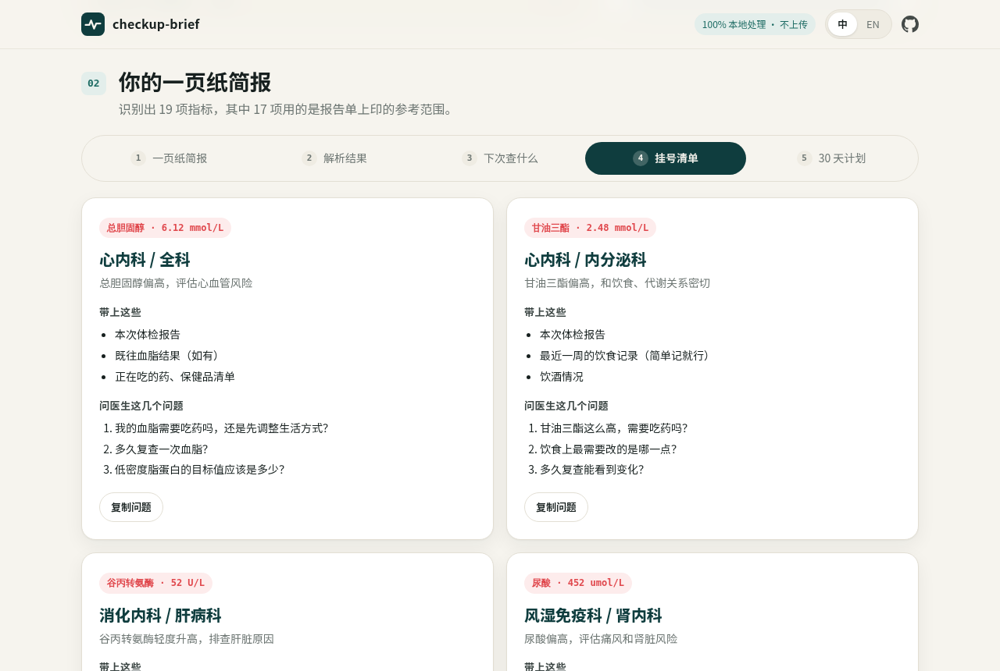
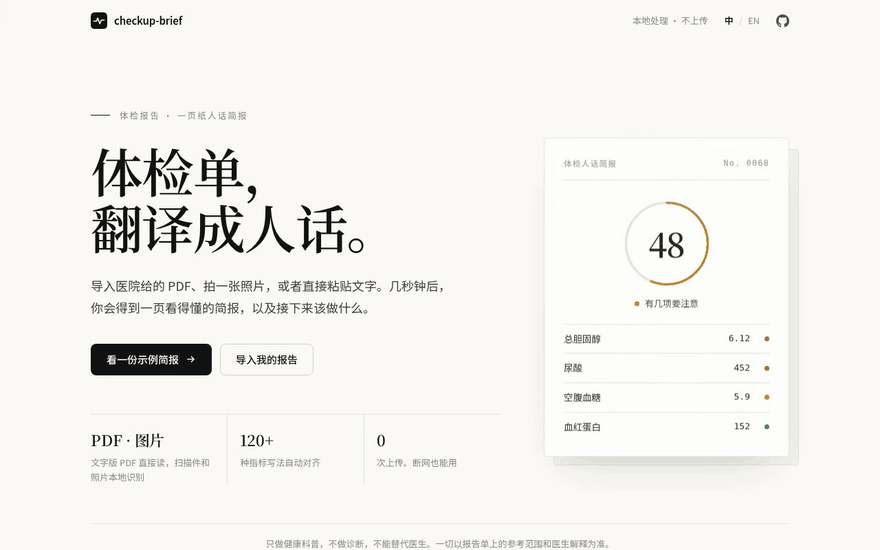
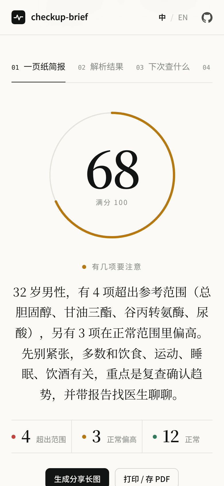
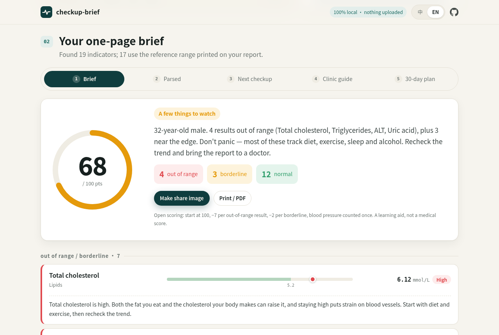

<p align="center">
  
</p>

<p align="center">
  <a href="https://checkupbrief.ggff.net/"><b>在线体验</b></a> ·
  <a href="https://checkup-brief.pages.dev/">备用地址</a> ·
  <a href="#快速开始">快速开始</a> ·
  <a href="#五个功能">五个功能</a> ·
  <a href="README_EN.md">English</a>
</p>

<p align="center">
  <a href="https://github.com/TTNAN/checkup-brief/actions/workflows/ci.yml"></a>
  
  
  
  <a href="LICENSE"></a>
</p>

> [!IMPORTANT]
> **只做健康科普，不做诊断，不能替代医生。** 一切以报告单上的参考范围和医生的解释为准。

**checkup-brief** 把医院给的体检报告——**PDF、照片、截图或文字**——变成一页能看懂的人话简报：总分、红黄绿灯、每项异常一句人话，再告诉你下次该查什么、该挂哪个科、接下来 30 天怎么改。

全部在你的浏览器里完成——PDF 解析和中文 OCR 也在本地跑，不上传、不注册、断网可用。

## 30 秒看懂

<p align="center">
  
</p>

## 为什么做这个

每年体检完，报告单上的数字大多数人都看不懂：

- **总胆固醇 6.12 是什么意思？尿酸 452 要不要紧？** 报告全是术语和数字，只能等医生一句“没啥大问题”。
- **每家医院写法都不一样。** ALT、谷丙转氨酶、丙氨酸氨基转移酶是同一个东西，复制粘贴都对不上。
- **异常了不知道挂什么科，见了医生不知道问什么。**
- **只告诉你“血脂高”，不告诉你接下来具体做什么。**
- **看完就扔抽屉**，下次体检不知道该加什么、该省什么。

直接丢给大模型也行，但它会编参考范围、每次说法不一样，还得把整份报告传上云。checkup-brief 换了个思路：

| | 直接问大模型 | checkup-brief |
| --- | --- | --- |
| 红黄绿判定 | 靠模型“记得”的范围，可能编 | 优先用**报告单上印的范围**，确定性、可复算 |
| 计分 | 每次不一样 | 规则公开写在代码里，同一份报告永远同一个分 |
| 隐私 | 整份报告上传云端 | **100% 本地**，PDF / 照片也在本机识别 |
| 照片识别出错 | 不知道哪里错了 | 漏小数点等常见 OCR 错误自动修正并**标出来让你核对** |
| 下一步 | 一段长回答 | 套餐、科室、问题清单、30 天打卡，直接能用 |

## 五个功能

### 1. 一页纸人话简报

核心产物。一份报告对应一页简报：

- **总分**（满分 100，[规则公开](#计分规则)）+ 一句话总结
- **红黄绿灯**：超出范围 / 正常偏高 / 正常，每项都画出“你的数值落在参考范围的哪里”
- **每项异常一句人话**，不说术语
- **一键生成分享长图**，发给家人；也能直接打印 / 存 PDF 带去见医生
- **家庭档案**：帮爸妈也建一份。按成员（爸爸、妈妈、我……）分开存报告和 30 天打卡，年龄、性别、家族史自动带入“下次查什么”；整个家庭档案可导出成一个 JSON 文件，换手机或发给爸妈再导入，依旧只存在本机

<p align="center">
  
  
</p>

### 2. 中文体检解析器 · PDF / 照片导入

国内医院的报告大多是 PDF，所以导入是第一等公民：

- **文字版 PDF**：直接读取文字层，按坐标还原成“一行一项”，表格版报告也能对齐；顺手修掉 PDF 里常见的“部首字”（⾎、⽩、⻔ 看着一样、编码不同）
- **扫描件 PDF / 手机照片 / 截图**：浏览器内中文 OCR（tesseract.js，模型约 10 MB，首次加载后缓存），**图片不出本机**
- **OCR 纠错**：“6.12”认成“612”、“↑”认成“1”、单位乱码……按参考范围自动修正，并在简报里**标黄提示核对**
- 也可以直接粘贴文字、拖入 `.txt`，或 Ctrl+V 粘贴截图
- **别名归一**：30 个常见指标、120+ 种写法（ALT = 谷丙转氨酶 = 丙氨酸氨基转移酶……），见 [`src/aliases.js`](src/aliases.js)
- **兼容各种格式**：全角括号、`↑ ↓ H L` 标记、`3.9-6.1 / 3.9~6.1 / 0.00--1.70 / ≤5.2` 等参考范围写法
- **报告单范围优先**，没印才用内置范围（[`src/reference-ranges.js`](src/reference-ranges.js)：血常规、血糖、血脂、肝肾、尿酸、甲状腺、血压、BMI）
- 输出结构化 JSON，可以直接接到你自己的程序里

<p align="center"></p>
<p align="center"></p>

### 3. 下次查什么（体检套餐选择器）

根据年龄、性别、家族史、预算和本次异常，告诉你下次体检：

- **建议加查**：针对本次异常的复查（血脂复查、肝脏超声、尿酸 + 肾功能……），附大致价格和总花费 vs 预算
- **可选**：按年龄 / 性别 / 家族史的基础筛查，年龄、性别阈值对齐国家卫健委《成人健康体检项目推荐指引（2025 年版）》，每条附依据
- **可以省掉**：盲目加做全套肿瘤标志物、重复查已正常的项目、预算内不必要的高端影像

<p align="center"></p>

### 4. 挂号 + 问诊清单

每个异常对应一张卡片：**该挂什么科**、**带什么资料**、**问医生哪几个问题**，一键复制问题清单。同一件事只出一张卡（收缩压、舒张压合并成“血压”）。

<p align="center"></p>

### 5. 30 天改善计划

只讲吃、动、睡，**不给药、不给剂量**：

- 每天只做 **3 件小事**，每周一个主题：先记下来 → 换掉一顿 → 动起来 → 复盘
- 按你的异常追加针对性提醒（尿酸高就多喝水、转氨酶高就先戒酒……）
- **30 天打卡日历**，连续天数一目了然；数据只存在你自己的浏览器里

<p align="center"></p>

> 另外：整页支持 **中文 / English** 一键切换、手机端。

<details>
<summary>📱 手机端 / 🌐 English 截图</summary>
<p align="center">
  
  
</p>
</details>

## 快速开始

### 在线体验

打开 **<https://checkupbrief.ggff.net/>**，拖入你的 PDF / 照片，或者点“示例 PDF”“示例照片”试试。想直接看结果：[`/#demo`](https://checkupbrief.ggff.net/#demo)。

### 本地打开

不用安装任何东西。粘贴文字的话双击 `web/index.html` 就能用；PDF / 照片导入需要通过本地服务器打开（浏览器不允许 `file://` 页面加载识别模型）：

```bash
git clone https://github.com/TTNAN/checkup-brief.git
cd checkup-brief
python3 -m http.server 8000
# 打开 http://localhost:8000
```

### 命令行

```bash
# 生成 Markdown 简报
node bin/checkup-brief.js examples/sample-report.txt --age 32 --sex male > brief.md

# 只要结构化结果
node bin/checkup-brief.js examples/sample-report.txt --json

# 英文版
node bin/checkup-brief.js examples/sample-report.txt --age 32 --sex male --lang en
```

### 在代码里用

所有模块都是零依赖的纯函数，浏览器 `<script>` 和 Node `require` 都能用：

```js
const { parseReportText } = require('./src/parser.js');
const { buildBriefing } = require('./src/briefing.js');

const items = parseReportText(reportText);              // 解析 + 红黄绿判定
const brief = buildBriefing(items, { age: 32, sex: 'male' }); // 总分 + 人话讲解
console.log(brief.score, brief.level);                  // 68 '有几项要注意'
```

| 函数 | 作用 |
| --- | --- |
| `parseReportText(text)` | 报告文字 → `[{ id, name, value, unit, range, status, flag }]` |
| `buildBriefing(items, profile, lang)` | 总分、等级、总结、每项人话讲解 |
| `recommendPackage({ items, profile, budget, lang })` | 加查 / 可选 / 可省 + 花费估算 |
| `buildClinicGuide(items, lang)` | 科室、带什么、问什么 |
| `buildPlan30d(items, profile, lang)` | 4 周主题、每天 3 件小事、30 天打卡表 |
| `renderMarkdown(text, profile, lang)` | 一步生成整份 Markdown 简报 |

完整示例：[输入](examples/sample-report.txt) → [解析结果](examples/sample-report.json) → [简报](examples/sample-brief.md)。

## 计分规则

公开、可复算，**不是医学评分**：

- 满分 100；超出范围一项 **−7**，正常偏高 / 偏低一项 **−2**，最低 0 分
- 收缩压 + 舒张压只按“血压”**算一次**（取较差的那项）
- 正常偏高：落在范围内、但离上限不到区间宽度的 10%；血压按临床分界（收缩压 120–139、舒张压 80–89）
- 90+ 挺好 · 75–89 总体不错 · 60–74 有几项要注意 · 60 以下建议尽快找医生聊聊

示例（32 岁男性）：4 项超出范围 −28，空腹血糖和血压正常偏高 −4，**总分 68**。

## 隐私

- 解析、计分、推荐全部在本地完成，**不上传**你的报告
- 页面没有统计、没有埋点、没有任何第三方请求；PDF.js、OCR 模型、字体都打包在仓库里（[web/vendor](web/vendor/README.md)），不走 CDN
- 家庭档案只存在本机浏览器：成员资料和 30 天打卡在 `localStorage`，报告只存识别出的文字和分数（IndexedDB），**不存原始照片 / PDF**；每份报告、每位成员都能单独删除
- 导出的家庭档案是一个本地生成的 JSON 文件，导入也在本机完成，全程不联网
- 请不要把真实体检报告贴到 Issue / PR / 截图里。详见 [docs/PRIVACY.md](docs/PRIVACY.md)

## 仓库结构

```
checkup-brief/
├── web/                 演示页（index.html / styles.css / app.js）
│   ├── import.js            PDF / 图片 / 文本导入（本地）
│   ├── vendor/              pdf.js、tesseract.js 及中文模型（按需加载）
├── src/
│   ├── parser.js            解析 + 判定
│   ├── aliases.js           指标别名表
│   ├── reference-ranges.js  内置参考范围
│   ├── briefing.js          ① 一页纸简报
│   ├── package-recommender.js ③ 下次查什么
│   ├── clinic-guide.js      ④ 挂号清单
│   ├── plan-30d.js          ⑤ 30 天计划
│   ├── family.js            家庭档案：成员、报告存档、导出导入
│   └── markdown.js          整份 Markdown 简报
├── bin/checkup-brief.js 命令行
├── tests/               零依赖单元测试（node --test）
├── examples/            示例：文字 / PDF / 照片 / JSON / 简报（全是编的数据）
├── scripts/             重新生成 README 截图和动图
└── docs/                架构、隐私、路线图、贡献指南、README 素材
```

## 路线图

- [x] 五个模块 + 中 / EN + 分享长图 + 打印
- [x] 解析器测试用例、命令行
- [x] PDF / 照片 / 截图导入，本地 OCR + 自动纠错
- [ ] 更多医院报告版式（美年、爱康、慈铭、公立医院……）
- [ ] 一份报告多页、多个科室时按科室分组
- [ ] 可选的大模型讲解：只发已判好的异常指标，默认关闭

完整路线图见 [docs/ROADMAP.md](docs/ROADMAP.md)。明确不做：多年趋势热力图、诊断、开药、账号和云同步。

## 贡献

最有帮助的贡献：补指标别名、补参考范围、补医院报告格式、修解析 bug、改人话文案。请只用脱敏或明显编造的数据，详见 [docs/CONTRIBUTING.md](docs/CONTRIBUTING.md)。

```bash
npm test   # 等于 node --test tests/*.test.js，没有任何依赖要装
```

## 免责声明

本项目只做健康科普，不做诊断，不能替代医生和正规检查。指标受性别、年龄、试剂、医院区间影响，一切以报告单上的参考范围和医生解释为准。涉及用药、停药、复查间隔的决定，请一定找医生。

## 请我喝杯咖啡

如果这个项目帮你省了点时间，欢迎请我喝杯咖啡。☕

| 微信赞赏码 |
| -------- |
|  |

## License

[MIT](LICENSE) © TTNAN
