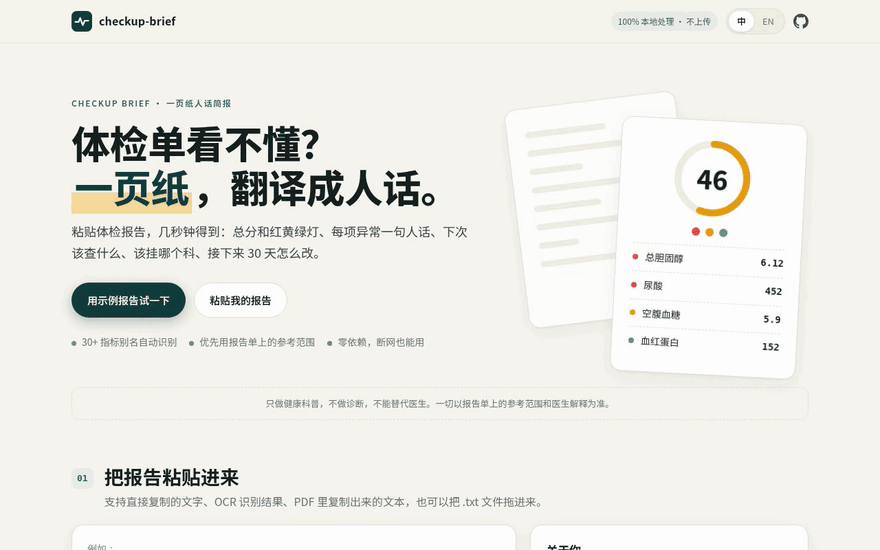
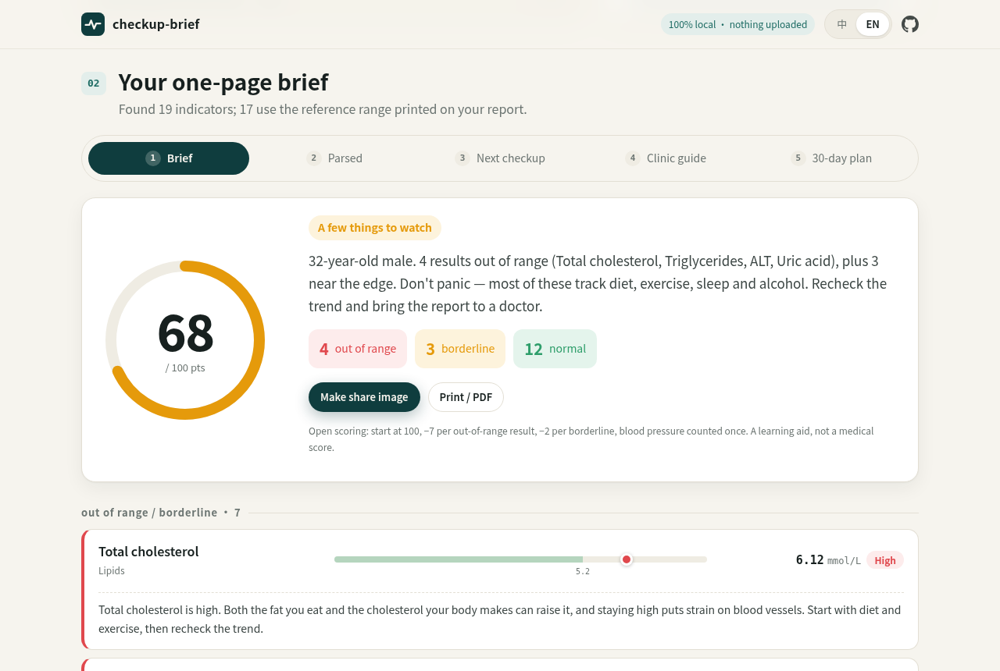
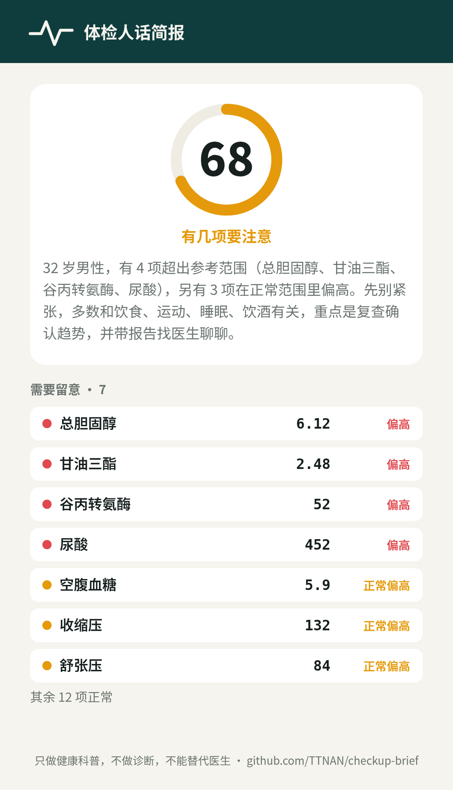
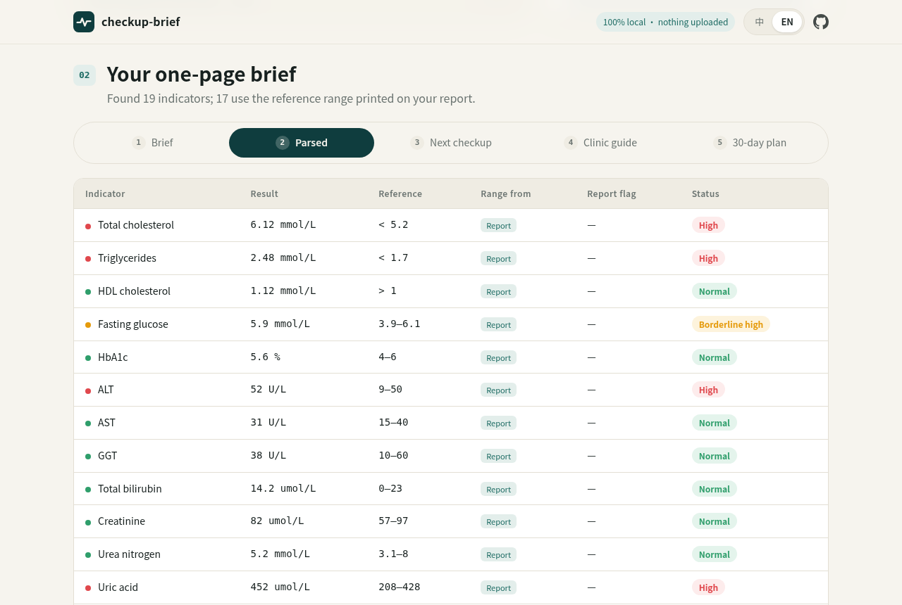
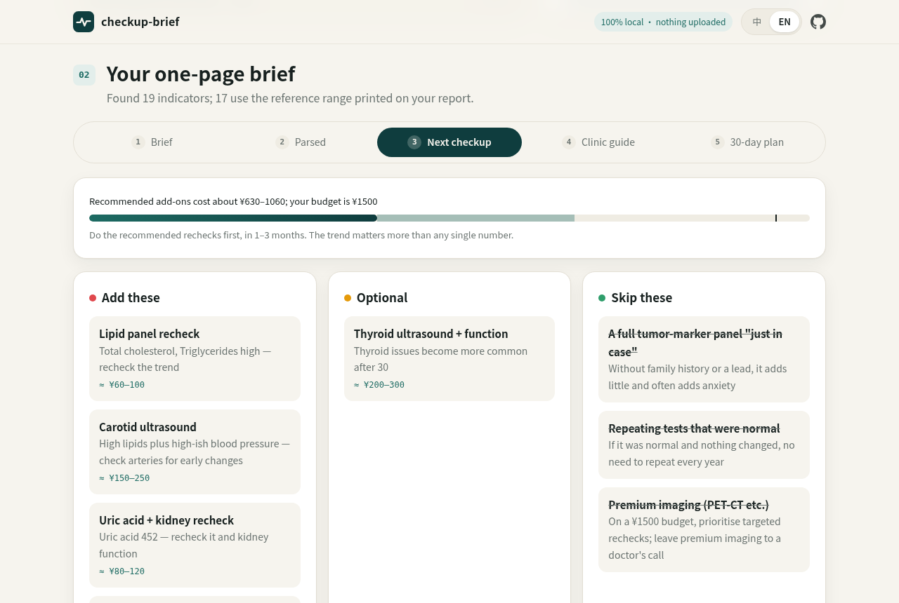
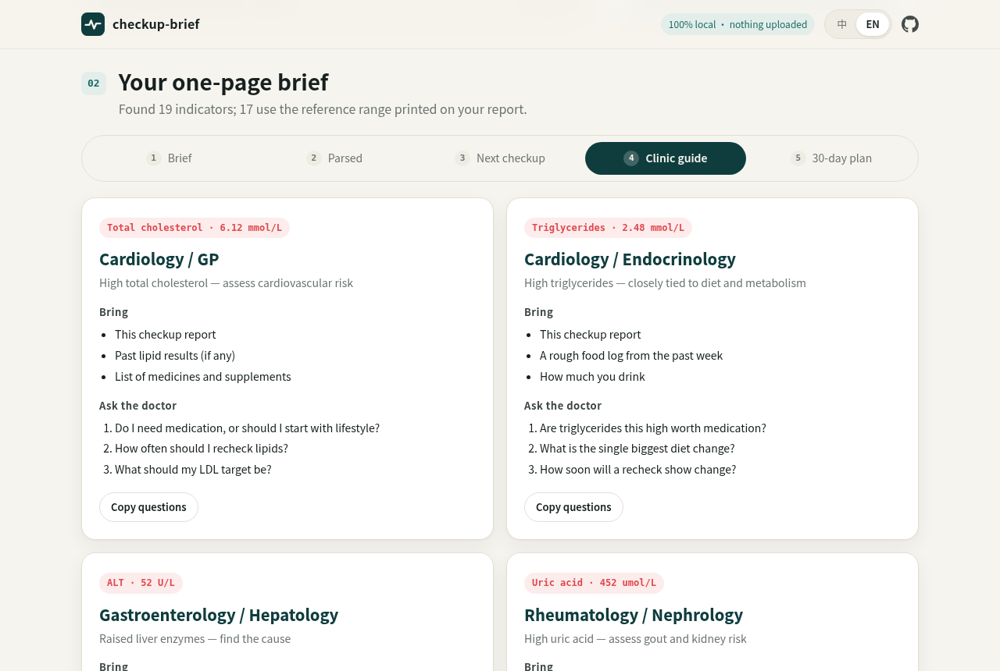
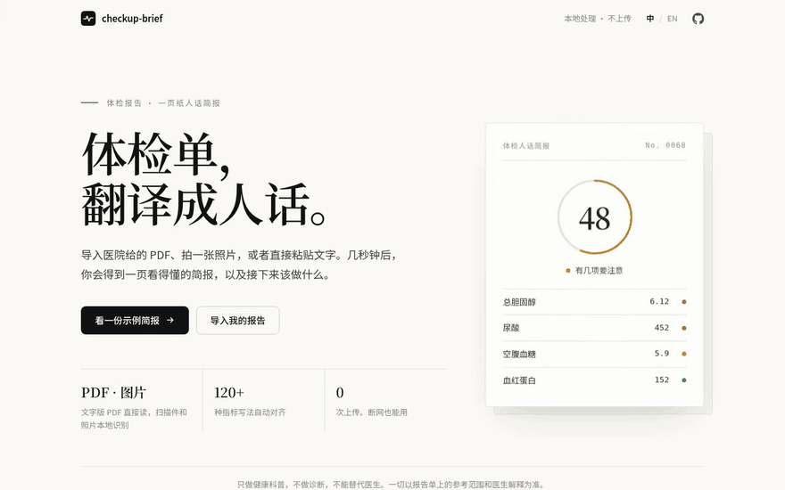

<p align="center">
  
</p>

<p align="center">
  <a href="https://ttnan.github.io/checkup-brief/"><b>Live demo</b></a> ·
  <a href="#quick-start">Quick start</a> ·
  <a href="#five-features">Five features</a> ·
  <a href="README.md">中文</a>
</p>

<p align="center">
  <a href="https://github.com/TTNAN/checkup-brief/actions/workflows/ci.yml"></a>
  
  
  
  <a href="LICENSE"></a>
</p>

> [!IMPORTANT]
> **For health education only. Not a diagnosis, and not a substitute for a doctor.** The reference ranges on your report and your doctor's reading always come first.

**checkup-brief** turns a checkup report you can't read into a one-page brief you can: a score, red / yellow / green lights, one plain sentence per abnormal result — plus what to check next time, which department to see, and what to change over the next 30 days.

Everything runs in your browser. No upload, no sign-up, no network, no dependencies.

## 30-second tour

<p align="center">
  
</p>

## Why

After every checkup, most people stare at numbers they can't interpret:

- **Is a total cholesterol of 6.12 bad? Does uric acid 452 matter?** The report is all jargon.
- **Every hospital writes it differently.** ALT, 谷丙转氨酶 and 丙氨酸氨基转移酶 are the same test.
- **Nobody tells you which department to book, or what to ask.**
- **"Lipids high" — and then what, exactly, for the next 30 days?**
- **The report goes in a drawer**, and next year nobody remembers what to add or skip.

You could paste it into a chatbot, but it may invent reference ranges, answer differently each time, and needs the whole report uploaded. checkup-brief takes a different route:

| | Ask a chatbot | checkup-brief |
| --- | --- | --- |
| Traffic lights | From ranges the model "remembers" — may be made up | Uses the **ranges printed on your report** first; deterministic |
| Score | Changes every time | Open rules in code; same report, same score |
| Privacy | Whole report sent to the cloud | **100% local**, works offline |
| Next steps | One long answer | Package, departments, questions, a 30-day check-in — ready to use |

## Five features

### 1. One-page plain-language brief

- **Score** out of 100 ([open rules](#scoring)) plus a one-line summary
- **Traffic lights** with a gauge showing where your value sits in the reference range
- **One plain sentence** per abnormal result
- **Share image** in one click; or print / save as PDF for your doctor

<p align="center">
  
  
</p>

### 2. Chinese checkup parser

- Paste text, OCR output, text copied from a PDF, or drop a `.txt` file
- **Alias normalisation**: 30 common indicators, 120+ spellings — see [`src/aliases.js`](src/aliases.js)
- **Tolerant**: full-width brackets, `↑ ↓ H L` flags, `3.9-6.1 / 3.9~6.1 / 0.00--1.70 / ≤5.2` range formats
- **Report ranges first**, built-in ranges as fallback ([`src/reference-ranges.js`](src/reference-ranges.js))
- Structured JSON output

<p align="center"></p>

### 3. What to check next time

Based on age, sex, family history, budget and this report's gaps:

- **Add**: targeted rechecks, with rough prices and total vs budget
- **Optional**: baseline screening by age / sex / family history
- **Skip**: tumor-marker panels "just in case", repeating normal tests, premium imaging beyond your budget

<p align="center"></p>

### 4. Clinic guide

One card per issue: **which department**, **what to bring**, **what to ask** — copy the questions in one tap. Related results share one card (systolic + diastolic = "blood pressure").

<p align="center"></p>

### 5. 30-day plan

Eat, move, sleep — **no medication, no doses**:

- **Three small things a day**, one theme a week: write it down → swap one meal → get moving → review
- Extra tips matched to your results
- **30-day check-in calendar** with a streak; stored only in your browser

<p align="center"></p>

> Also: one-click 中文 / English, dark mode, mobile layout.

## Quick start

### Live demo

Open **<https://ttnan.github.io/checkup-brief/>** and click "Try the sample report", or jump straight to the result: [`/#demo`](https://ttnan.github.io/checkup-brief/#demo).

### Run locally

Nothing to install — double-click `web/index.html`. Or:

```bash
git clone https://github.com/TTNAN/checkup-brief.git
cd checkup-brief
python3 -m http.server 8000
# open http://localhost:8000
```

### Command line

```bash
node bin/checkup-brief.js examples/sample-report.txt --age 32 --sex male --lang en > brief.md
node bin/checkup-brief.js examples/sample-report.txt --json
```

### As a library

Zero-dependency pure functions; work with a browser `<script>` or Node `require`:

```js
const { parseReportText } = require('./src/parser.js');
const { buildBriefing } = require('./src/briefing.js');

const items = parseReportText(reportText);
const brief = buildBriefing(items, { age: 32, sex: 'male' }, 'en');
console.log(brief.score, brief.level); // 68 'A few things to watch'
```

| Function | What it does |
| --- | --- |
| `parseReportText(text)` | text → `[{ id, name, en, value, unit, range, status, flag }]` |
| `buildBriefing(items, profile, lang)` | score, level, summary, plain-language explanations |
| `recommendPackage({ items, profile, budget, lang })` | add / optional / skip + cost estimate |
| `buildClinicGuide(items, lang)` | department, what to bring, what to ask |
| `buildPlan30d(items, profile, lang)` | 4 weekly themes, 3 tasks a day, 30-day checklist |
| `renderMarkdown(text, profile, lang)` | the whole brief as Markdown |

Full example: [input](examples/sample-report.txt) → [parsed JSON](examples/sample-report.json) → [brief](examples/sample-brief.md).

## Scoring

Open and reproducible — **not a medical score**:

- Start at 100; **−7** per out-of-range result, **−2** per borderline; floor 0
- Systolic + diastolic count **once** as blood pressure (the worse of the two)
- Borderline = inside the range but within 10% of its width from an edge; blood pressure uses clinical cut-offs (120–139 / 80–89)
- 90+ looking good · 75–89 mostly good · 60–74 a few things to watch · below 60 talk to a doctor soon

Sample (32-year-old male): 4 out of range −28, fasting glucose and blood pressure borderline −4 → **68**.

## Privacy

- Parsing, scoring and recommendations all happen locally; nothing is uploaded or stored
- No analytics, no tracking, no third-party requests, no external fonts or CDNs
- Check-ins and language preference live only in your browser's `localStorage`
- Please never post a real report in issues, PRs or screenshots. See [docs/PRIVACY.md](docs/PRIVACY.md)

## Roadmap

- [x] Five modules, 中 / EN, share image, print
- [x] Parser tests, CLI
- [ ] More hospital report layouts
- [ ] Photo / PDF import with local OCR
- [ ] Optional LLM explanations — send only the already-judged abnormal values; off by default

See [docs/ROADMAP.md](docs/ROADMAP.md). Out of scope: multi-year trend heatmaps, diagnosis, prescriptions, accounts, cloud sync.

## Contributing

Most useful: indicator aliases, reference ranges, hospital report formats, parser fixes, better plain-language copy. Use anonymised or obviously made-up data only — see [docs/CONTRIBUTING.md](docs/CONTRIBUTING.md).

```bash
npm test   # node --test tests/*.test.js, nothing to install
```

## Disclaimer

Health education only. Not a diagnosis and not a substitute for a doctor or proper tests. Results depend on sex, age, reagents and each hospital's ranges; your report and your doctor come first. For anything about medication or recheck intervals, see a doctor.

## License

[MIT](LICENSE) © TTNAN
